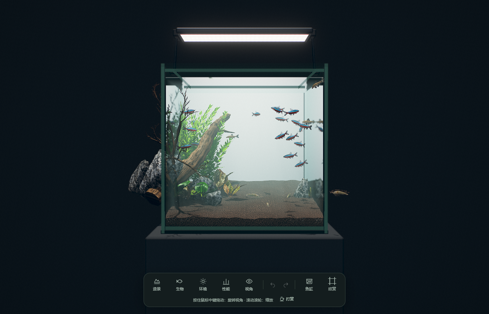

# tankwright · 3D 鱼缸设计预览系统

**在浏览器里设计鱼缸：改尺寸、看结构、算下料、出报价，同时直接在里面造景。**

A browser-based aquarium tank designer — parametric glass structure, cut list, quotation, and a live 3D aquascape in one page.



---

## 这个工具解决什么

市面上做鱼缸的工具通常只做一半：

- **结构设计工具**能算出玻璃尺寸和底滤布局，但看不到成品什么样子
- **造景模拟器**能把水草石头摆得很好看，但不知道缸怎么下料、多少钱

tankwright 把两半接在一起。左侧参数一改，3D 缸体即时重建，右侧下料清单与报价同步刷新，造景层直接叠在正确的缸体几何上。

## 功能

### 结构设计

- **8 种缸型**：标准缸 / 铝架 / 系统组缸 / 底滤 / 上滤 / 背侧滤 / 客厅缸 / 海鲜池
- **14 个参数**驱动整缸：长宽高、侧板/底板/隔板厚度、胶缝、隔板数与切口、溢流宽度、沙缸宽度、泵仓宽度、拉筋宽度、玻璃等级
- **自动板件拆解**：底板、四壁、拉筋、溢流板、隔板、沙缸/泵仓隔断，附带尺寸标注
- **参数联动**：隔板数按 ⌊长/125⌋ 夹紧、沙缸与泵仓互斥、切口过浅自动取消拉筋
- **开孔**：矩形开槽与圆孔钻孔，带过切余量

### 下料与报价

- 按材质与尺寸合并的下料清单，面积以平方米计
- 玻璃费 / 切割费 / 开孔费 / 胶费分项
- 缸外结构（柜体、灯架、铝型材）单列，**不计入玻璃面积**
- 导出 Excel（缸体清单 + 玻璃统计两个 sheet）

### 造景与预览

- 44 种鱼、多类水草、青龙石/沉木/底砂，全部参数化生成
- 相对水面的折射玻璃、焦散、水体、景深与泛光
- 23 种底床/石材/沉木材质
- 六套现成造景示例

### 分享与导出

- 设计参数编码进 URL，一条链接还原整套配置
- 导出带尺寸标注的 PNG 图纸

## 快速开始

```bash
cd web
pnpm install
pnpm dev          # 打开 http://127.0.0.1:5174
```

生产构建：

```bash
pnpm build        # 输出到 web/dist，可直接静态托管
```

测试：

```bash
pnpm test         # 279 个用例
```

## 架构

三层，依赖严格单向，毫米/米的单位边界只在一处。

```
model/      14 个参数 → 派生几何 Geom（毫米）
  ↓         参数校验与联动夹紧
rules/      声明式板件规则表（每种缸型只是一张清单）
  ↓
solver/     规则 + Geom → 板件数组 + 尺寸标注
  ↓         + 几何一致性检查 C1–C10
render/     板件 → three.js 网格（毫米→米唯一转换点）
quote/      板件 → 下料清单 + 报价
ui/         React 工程面板
export/     图纸 PNG / Excel
share/      URL 状态编解码
```

**声明式规则引擎**是关键设计：一种缸型不是一段拼装代码，而是一张「用哪些规则」的清单。

```ts
export const jarSpec: TankSpec = {
  kind: 'jar',
  label: '标准鱼缸',
  rules: [floorRule, frontBackRule, leftRightRule,
          braceRule, overflowRule, baffleRule],
};
```

八种缸型共享底板、四壁规则，只在隔板、溢流、沙缸上做增删。

### 几何一致性检查

`solver/assertions.ts` 不从任何外部输出对照，只检查几何自身的自洽性：

- 前后板外表面间距必须等于标称宽度
- 底板上表面必须等于底板厚
- 隔板必须等距
- 溢流宽度不足时**不得**生成溢流板
- 相邻板件不得侵入壁厚带

这套检查在开发过程中抓到过四个单元测试全绿却完全错误的缺陷：拉筋旋转到了错误的轴、拉筋嵌进侧壁 9mm、隔板成了纵向鳍片、隔断悬在缸外。

## 技术栈

| | |
|---|---|
| 构建 | Vite 6 |
| 语言 | TypeScript 5（底座保留 JS，`allowJs`）|
| 3D | three.js 0.170 |
| 布尔运算 | three-bvh-csg |
| UI | React 19（仅工程面板）|
| 测试 | Vitest + Testing Library |

## 目录

```
web/
├── src/
│   ├── model/      参数、派生几何、校验
│   ├── rules/      板件规则与缸型定义
│   ├── solver/     求解器与一致性检查
│   ├── render/     three.js 桥接与 CSG
│   ├── quote/      下料清单与报价
│   ├── ui/         React 面板
│   ├── export/     图纸与 Excel
│   └── share/      URL 状态
├── public/         运行时资源（贴图、鱼模型、预设）
├── third_party/    渲染底座（MIT，见下方致谢）
├── tests/          279 个用例
└── docs/spec/      几何规格（板件构造的唯一依据）
```

## 致谢

3D 渲染底座取自 [SkentSun/aquarium-editor](https://github.com/SkentSun/aquarium-editor)（MIT）——玻璃着色器、水体焦散、鱼群行为、水草与石材生成均来自该项目。tankwright 在它之上增加了结构设计、下料报价与工程面板。

几何规格见 [`docs/spec/tank-geometry.md`](docs/spec/tank-geometry.md)。

## 许可

MIT，见 [LICENSE](LICENSE)。
